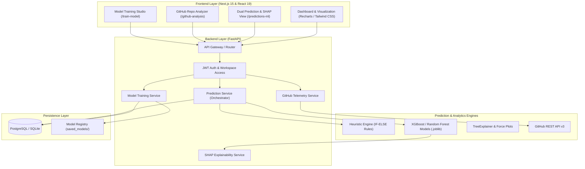

<div align="center">

# 🚀 AI Software Project Success / Failure Prediction System

An enterprise-ready, dual-engine predictive intelligence platform that forecasts software project outcomes, quantifies delivery risks, explains predictive drivers via SHAP, and conducts real-time GitHub repository static health analysis.

[](https://fastapi.tiangolo.com)
[](https://nextjs.org)
[](https://react.dev)
[](https://www.python.org/)
[](https://xgboost.ai/)
[](https://shap.readthedocs.io/)
[](https://tailwindcss.com)
[](LICENSE)

</div>

---

## 📌 Repository About & Topics

> **Description / About for GitHub:**  
> *Enterprise AI system predicting software project success and failure using dual-engine ML (XGBoost) and heuristics, SHAP explainability, live GitHub repo health analysis, and interactive Next.js dashboards.*

**GitHub Topics / Tags:**  
`machine-learning` • `fastapi` • `nextjs` • `xgboost` • `shap` • `project-management` • `predictive-analytics` • `github-api` • `software-engineering` • `risk-assessment` • `explainable-ai` • `python` • `typescript`

---

## 📖 Table of Contents

- [Overview](#-overview)
- [Key Features](#-key-features)
- [System Architecture](#-system-architecture)
- [Tech Stack](#-tech-stack)
- [Project Structure](#-project-structure)
- [Quick Start Guide](#-quick-start-guide)
  - [Prerequisites](#prerequisites)
  - [Option 1: Docker Compose (Fastest)](#option-1-docker-compose-fastest)
  - [Option 2: Local Setup](#option-2-local-setup)
- [API Reference](#-api-reference)
- [Machine Learning & Explainability](#-machine-learning--explainability)
- [GitHub Analysis Pipeline](#-github-analysis-pipeline)
- [Testing](#-testing)
- [Contributing & License](#-contributing--license)

---

## 🎯 Overview

Software and AI projects frequently encounter budget escalations, delivery timeline slippages, scope creep, and unexpected quality crises. The **AI Success/Failure Prediction System** provides engineering leaders, PMs, and stakeholders with early-warning indicators and probabilistic forecasts before costly failures materialize.

By synthesizing classical project management parameters (budget, team velocity, requirements volatility, bug density) with static engineering metrics extracted straight from GitHub repositories, the system delivers high-precision, interpretable assessments.

---

## ✨ Key Features

- **⚡ Dual-Engine Predictive Intelligence**:
  - **Baseline Heuristic Engine**: Deterministic IF-ELSE rule evaluation delivering immediate health and risk scoring.
  - **Machine Learning Engine**: Trained XGBoost / Random Forest models offering probabilistic classification (`Success` vs. `Failure`).
  - **Fail-Safe Operation**: Graceful automatic fallback to baseline heuristics if ML models are uninitialized or offline.
- **🔍 Explainable AI (SHAP Integration)**:
  - Granular feature-attribution analysis using SHapley Additive exPlanations.
  - Highlights top positive and negative drivers influencing each prediction.
  - Generates plain-English narrative summaries for non-technical leadership.
- **🐙 Automated GitHub Repository Health Analysis**:
  - Live inspection of GitHub repositories via public API or authenticated tokens.
  - Metrics tracked: commit cadence, open vs. closed issues, PR velocity, release frequency, stargazers, forks, and language composition.
  - Translates repo health into projected risk indicators for predictive ingestion.
- **🏋️ Custom Model Training & Versioning**:
  - Upload CSV or Excel datasets with custom team benchmarks.
  - Train, validate, benchmark, and deploy new model iterations directly from the UI.
  - Multi-version management with single-click active model hot-swapping.
- **🏢 Multi-Tenant Workspaces & RBAC**:
  - Isolated organizational workspaces.
  - Role-Based Access Control (Admin / Member permissions).
  - Secure JWT-based authentication with bcrypt password hashing.
- **📊 Interactive Next.js Dashboard**:
  - Real-time telemetry powered by React 19, Next.js 15, and Recharts.
  - Longitudinal prediction history tracking with drift and trend visualization.
  - One-click PDF executive summary and Excel spreadsheet export.

---

## 🏗️ System Architecture



---

## 🛠️ Tech Stack

| Domain | Technology | Description |
| :--- | :--- | :--- |
| **Backend Framework** | [FastAPI](https://fastapi.tiangolo.com/) | Asynchronous, high-performance Python web framework |
| **Data Science / ML** | [XGBoost](https://xgboost.ai/), [scikit-learn](https://scikit-learn.org/) | Gradient boosted decision trees, random forests, pipelines |
| **Explainable AI** | [SHAP](https://github.com/slundberg/shap) | Game-theoretic feature attribution and explanation |
| **Database & ORM** | [SQLAlchemy](https://www.sqlalchemy.org/) & [PostgreSQL](https://www.postgresql.org/) / SQLite | Relational schema, Alembic migration scripts |
| **Frontend Framework** | [Next.js 15](https://nextjs.org/) (App Router) | Server-rendered React framework |
| **UI & Styling** | [React 19](https://react.dev/), [Tailwind CSS 4](https://tailwindcss.com/) | Modern atomic styling & fluid components |
| **Charts & Animation** | [Recharts](https://recharts.org/), [Framer Motion](https://www.framer.com/motion/) | Dynamic analytical graphs and transition effects |
| **Containerization** | [Docker](https://www.docker.com/) & Docker Compose | Multi-container reproducible deployment |

---

## 📂 Project Structure

```text
├── backend/
│   ├── alembic_migrations.py        # Database migration execution script
│   ├── Dockerfile                   # Backend container definition
│   ├── requirements.txt             # Python dependencies
│   ├── saved_models/                # Pre-trained ML artifacts (.joblib)
│   │   ├── xgboost.joblib
│   │   ├── random_forest.joblib
│   │   └── active_config.joblib
│   └── app/
│       ├── main.py                  # FastAPI application entrypoint
│       ├── api/                     # REST API endpoints & dependency injection
│       │   ├── endpoints/           # auth, predictions, ml, github, models, reports
│       │   └── deps.py
│       ├── core/                    # Config, database connection, security/JWT
│       ├── models/                  # SQLAlchemy ORM database models
│       ├── schemas/                 # Pydantic validation schemas
│       └── services/                # Business logic (Training, SHAP, GitHub, Predictions)
├── frontend/
│   ├── Dockerfile                   # Frontend container definition
│   ├── package.json                 # Next.js scripts and npm dependencies
│   ├── next.config.ts               # Next.js configuration
│   └── src/
│       ├── app/                     # App router pages (login, dashboard, predictions, etc.)
│       │   └── (workspace)/         # Protected workspace views
│       ├── components/              # Reusable UI components (Navbar, Sidebar, Charts)
│       ├── context/                 # AuthContext and state providers
│       └── lib/                     # API client utilities (apiFetch)
├── tests/                           # Integration and unit tests
│   └── test_github_analysis.py
├── test_ml_features.py              # End-to-end ML & SHAP validation test suite
├── test_predictions.py              # Dual prediction validation script
├── docker-compose.yml               # Multi-service container orchestration
└── README.md                        # Documentation
```

---

## 🚀 Quick Start Guide

### Prerequisites
- **Python**: 3.10 or higher
- **Node.js**: 18.x or 20.x+ and **npm**
- **Git**

---

### Option 1: Docker Compose (Fastest)

Run both the FastAPI backend and Next.js frontend with a single command:

```bash
# Clone the repository
git clone https://github.com/Kaviya-41/Ai-success-failure-predict.git
cd Ai-success-failure-predict

# Start all containers
docker compose up --build
```

- Frontend: `http://localhost:3000`
- Backend API Docs (Swagger): `http://localhost:8000/docs`

---

### Option 2: Local Setup

#### 1. Backend Setup

```bash
# 1. Navigate to backend directory
cd backend

# 2. Create and activate a virtual environment
python -m venv venv

# On Windows:
venv\Scripts\activate
# On Linux/macOS:
# source venv/bin/activate

# 3. Install Python dependencies
pip install -r requirements.txt

# 4. Copy environment configuration
copy .env.example .env    # On Windows
# cp .env.example .env    # On Linux/macOS

# 5. Execute database migrations
python alembic_migrations.py

# 6. Start the FastAPI development server
uvicorn app.main:app --reload --host 0.0.0.0 --port 8000
```

#### 2. Frontend Setup

In a new terminal window:

```bash
# 1. Navigate to frontend directory
cd frontend

# 2. Copy environment configuration
copy .env.example .env.local    # On Windows
# cp .env.example .env.local    # On Linux/macOS

# 3. Install npm packages
npm install

# 4. Start Next.js development server
npm run dev
```

Visit **`http://localhost:3000`** in your browser.

---

## 🔌 API Reference

### Core Endpoints

| Method | Endpoint | Description | Auth Required |
| :--- | :--- | :--- | :---: |
| `POST` | `/api/auth/register` | Register new user account | No |
| `POST` | `/api/auth/login` | Authenticate and obtain JWT access token | No |
| `POST` | `/api/predictions/predict` | Generate dual baseline + ML prediction with SHAP | Yes |
| `POST` | `/api/predictions/explain` | Generate standalone SHAP breakdown for input factors | Yes |
| `GET` | `/api/predictions/history` | Retrieve historical predictions for a project | Yes |
| `POST` | `/api/github/analyze` | Ingest GitHub repository link and compute metrics | Yes |
| `POST` | `/api/models/train` | Train new XGBoost/Random Forest model on dataset | Yes |
| `GET` | `/api/models/versions` | List all trained model versions and metrics | Yes |
| `POST` | `/api/models/activate/{version_id}` | Hot-swap active production model | Yes |
| `GET` | `/api/reports/pdf/{project_id}` | Generate executive PDF report | Yes |

### Prediction Payload Example (`POST /api/predictions/predict`)

```json
{
  "budget": 120000,
  "duration_days": 180,
  "team_size": 6,
  "team_experience_years": 4,
  "project_complexity": 3,
  "requirement_changes": 2,
  "sprint_delays": 1,
  "bug_count": 12,
  "testing_coverage": 82,
  "client_involvement": 4,
  "resource_availability": 90,
  "customer_satisfaction": 4,
  "project_type": "Web",
  "include_ml": true,
  "include_shap": true,
  "save_history": true
}
```

### Sample Response Excerpt

```json
{
  "timestamp": "2026-11-20T21:40:00Z",
  "prediction_method": "XGBoost ML (trained)",
  "recommended_prediction": {
    "prediction": "Success",
    "probability": 84.6,
    "confidence_score": 88.0,
    "risk_level": "Low"
  },
  "shap_explanation": {
    "status": "success",
    "top_positive_factors": [
      { "feature_name": "testing_coverage", "value": 82, "shap_value": 0.35 },
      { "feature_name": "resource_availability", "value": 90, "shap_value": 0.22 }
    ],
    "top_negative_factors": [
      { "feature_name": "requirement_changes", "value": 2, "shap_value": -0.08 }
    ],
    "summary": "High testing coverage (82%) and optimal resource availability (90%) are the primary drivers of projected success."
  }
}
```

---

## 🧪 Testing

A comprehensive automated test suite validates ML pipeline training, serialization, SHAP explanations, and fallback mechanics:

```bash
# Run ML & SHAP integration tests
pytest test_ml_features.py -v

# Run dual-engine prediction validation
pytest test_predictions.py -v

# Run GitHub telemetry tests
pytest tests/test_github_analysis.py -v
```

---

## 📄 License

This project is licensed under the [MIT License](LICENSE).
